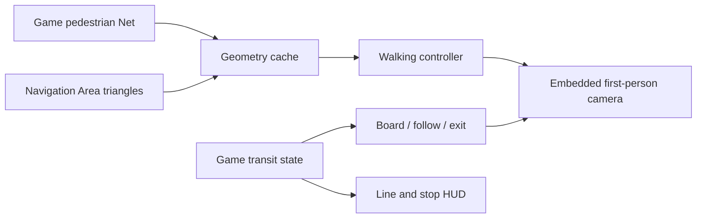

# How Real Walking works

## Entry and movement

The camera's position is captured before **Alt+F** switches to first person. The entry system searches nearby pedestrian paths and Navigation Area triangles, then chooses the nearest suitable point by **3D world distance**. Water and height checks reject unsuitable candidates.

While walking, the controller uses pedestrian **Net** curves as road corridors and **Navigation Area** triangles as surfaces for stairs, stations and other structures. It calculates the target surface height, constrains movement to the detected area, and allows movement to slide along boundaries. A short virtual slope can connect a pedestrian path to a Navigation Area ramp when their geometry leaves a small gap.

Different height layers are checked separately so a bridge and the road beneath it are not treated as the same surface. Walking height follows the selected surface directly. The vanilla **Pedestrian Street** uses a specific width adjustment; custom roads are not automatically given the same width.

Code: `src/Entry/`, `src/Navigation/`.

## Camera control

The embedded, adapted **First Person Camera Continued** engine handles first-person viewing, input and vehicle-follow transforms. Real Walking supplies the selected navigation height and horizontal constraints.

- **Navigation:** eye height follows the chosen walkable surface.
- **Free:** the camera keeps its absolute world altitude across terrain and water. `R` and `F` control altitude.
- **Riding:** the camera follows a selected transport vehicle until a permitted exit or mode switch.

Code: `FPCSource/`, `src/Bootstrap/`, `src/Navigation/RWCameraHeight.cs`.

## Public transport

The controller checks the vehicle type and stop state before showing the **E** boarding action. Boarding is restricted to stopped vehicles. When exiting, it chooses an eligible nearby pedestrian surface using rules specific to road vehicles, rail platforms, ferries and passenger ships. Ship-motion checks distinguish forward travel from ordinary wave movement. An exit is unavailable when no suitable landing is found.

The line/stop HUD reads the game's transport data without changing service scheduling.

Code: `src/Transit/`, `src/Routes/`.

## Design choices

Real Walking controls a local first-person camera rather than spawning a simulated citizen. It reads game navigation and transit data instead of altering traffic AI or saved simulation entities. It uses navigation geometry rather than physical collision meshes, so the walkable area depends on the paths exposed by the game and custom assets.

See [source map](SOURCE_MAP.md) and [development history](DEVELOPMENT_HISTORY.md).
